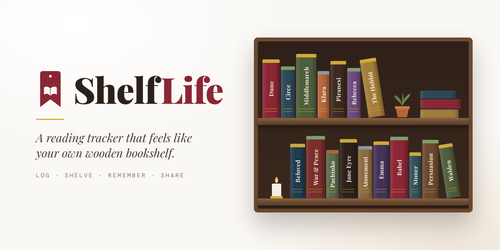

# ShelfLife



**A reading tracker that feels like your own wooden bookshelf.**

ShelfLife is an installable web app for readers. Every book you finish takes its place as a spine
on a warm, editorial-style shelf, coloured by how you felt about it. Over time your shelf becomes a
record of your reading life: what you loved, how fast you read, the quotes you kept, and a
"Year in Review" worth sharing. Sign in with Google, and your library follows you to any device.

Created by **Mike Warren** ([@dinosaurmike](https://github.com/dinosaurmike)).

---

## What it does

**Your shelf**
- Books stand as tactile spines on a wooden shelf: real cover art, 3D lighting, and a coloured
  headband for how you felt (loved, liked, mixed, disliked). Switch to classic sentiment colours
  any time.
- Monthly and quarterly bookmark ribbons, a lifetime view across every year, and five themes
  (Classic, Wood, Dark Wood, Library, Minimal).
- **Cozy Mode**: a calmer, simplified main screen for readers who just want their shelf.

**Logging a book**
- Scan the ISBN barcode or the cover (on-device OCR), search, enter it by hand, or import a CSV.
- Rich records: dates, format, genre, word count (the measure of length, with page counts
  converted), mood and theme tags, a one-line review, favourite quotes, re-reads, a private lock.
- Currently reading and to-read shelves alongside finished books.

**Seeing your reading**
- Quick stats, streaks, monthly pace, words read, fastest reads and longest books.
- **Reading DNA**: a radar of what you actually read, and **For You** recommendations scored
  against your taste and trajectory, never repeating a book you've read.
- **Year in Review**: an animated, shareable story of your reading year, plus monthly recaps.
- **The Reading Tree**: your reading history grown into a tree, with buried treasures to find.
- A trophy room of achievements, with a "Book of the Year" crown.

**Reading with others**
- Share your shelf with a link or QR code: anyone can browse it, read-only, without signing in.
  Lock any book to keep it off your shared shelf.
- Follow readers, a social feed, and a Discover grid of readers with similar taste, each with a
  profile page (with a privacy setting for whether others can discover you).
- Leave a friend a note tied to a book and a milestone; it pops up when they reach it.
  Recommend a book straight to a friend's inbox.
- **Book clubs**: pick the club's next read with a single search box, with suggestions from the
  group's taste, and chat about it.

**Made to keep**
- Installable as an app on phones and computers (PWA), works offline.
- Export your library as CSV or JSON at any time; your data is yours.
- **Laser Output**: turn your shelf into a single-line SVG ready for a laser engraver or plotter.

## Try it

ShelfLife runs at **<https://dinomike.ca/shelflife>**. Open it on your phone or computer, sign in
with Google (or view the demo shelf), and use your browser's **Install** / **Add to Home Screen**
to keep it as an app.

## How it's built

- **Front end:** HTML, CSS and vanilla JavaScript modules, bundled with [Vite](https://vite.dev).
  Hand-made SVG and canvas visualisations; no UI framework.
- **Back end:** [Supabase](https://supabase.com) (Postgres, Google sign-in, and Row-Level Security
  on every table, so each reader can only reach their own data and what others share).
- **Scanning:** QuaggaJS and ZXing (barcodes) and Tesseract.js (cover text), loaded only when needed.
- **Hosting:** any static host; [Netlify](https://netlify.com) configuration included, with one
  small serverless function for AI-assisted review polishing (Gemini, key kept in Netlify).
- **PWA:** web app manifest and a network-first service worker.

### Project layout

```
index.html              the app's page (styles and markup)
src/                    the app's code: core (app, auth, database), features, components, utils
analytics.html          admin usage dashboard
reading_tree.html       The Reading Tree
laseroutput.html        Laser Output (single-line SVG of your shelf)
privacy.html            privacy policy
libs/                   barcode and OCR libraries (loaded on demand)
icons/, manifest.json, sw.js, _redirects    app icons, PWA manifest, service worker, Netlify routing
migrations/             database migrations (SQL, run in order in Supabase)
netlify/functions/      the review-polishing function
scripts/                build helper and one-off data scripts (use environment variables for keys)
docs/                   setup guide and images
```

### Running it yourself

See **[docs/SETUP.md](docs/SETUP.md)** for the full walkthrough. In short:

```bash
npm install
npm run dev      # local development at http://localhost:8000
npm run build    # a complete site in dist/, ready to upload to a static host
```

## Privacy

ShelfLife only uses your basic Google profile (name, email and picture) to sign you in. Your books
are stored in the app's database, protected by per-reader access rules. Your shelf is shareable by
link or QR code (read-only); books you lock stay private. Full details: [privacy.html](privacy.html).

## License

© 2026 Mike Warren. All rights reserved. The code is shared here so you can see how it's made; it
isn't licensed for reuse. See [LICENSE](LICENSE). The bundled third-party libraries keep their own
licences.
